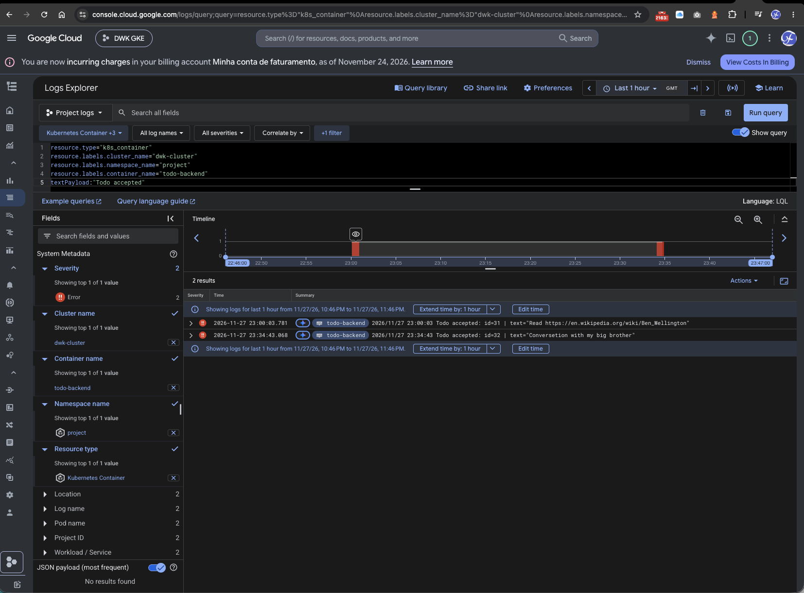

# Exercise 3.12 – GKE Monitoring and Application Logs

## Objective

Enable and verify Google Kubernetes Engine (GKE) monitoring and learn how to find application logs using Google Cloud Logging.

The exercise also demonstrates how to identify the log entry generated when a new Todo is created.

## GKE Monitoring Configuration

The GKE cluster `dwk-cluster` already had the required logging and monitoring components enabled.

The configuration was verified with:

```bash
gcloud container clusters describe dwk-cluster \
  --project dwk-gke-fjp-2026 \
  --zone europe-north1-b \
  --format="yaml(loggingConfig,monitoringConfig)"
```

### **Cloud Logging**

The following logging components were enabled:

- `SYSTEM_COMPONENTS`
- `WORKLOADS`

This allows application container logs to be collected by Google Cloud Logging.

### **Cloud Monitoring**

The following monitoring components were enabled:

- `SYSTEM_COMPONENTS`
- `STORAGE`
- `HPA`
- `POD`
- `DAEMONSET`
- `DEPLOYMENT`
- `STATEFULSET`
- `CADVISOR`
- `KUBELET`
- `DCGM`
- `JOBSET`

Managed Prometheus was also enabled.

## **Finding Application Logs**

Application logs can be accessed through Google Cloud Console:

1. Open **Logging > Logs Explorer**.
2. Select the GCP project `dwk-gke-fjp-2026`.
3. Filter the logs using the Kubernetes container resource.
4. Select the cluster, namespace and container.
5. Search for the message generated when a Todo is accepted.

The following Logs Explorer query was used:

```
resource.type="k8s_container"
resource.labels.cluster_name="dwk-cluster"
resource.labels.namespace_name="project"
resource.labels.container_name="todo-backend"
textPayload:"Todo accepted"
```

The query returned the application log entries from the `todo-backend` container.

## **Creating and Verifying a Todo**

A new Todo was created through the application:

`Conversetion with my big brother`

The backend generated the following log entry:

```
2026/11/27 23:34:43 Todo accepted: id=32 | text="Conversetion with my big brother"
```

The same event was verified directly in Kubernetes:

```
kubectl logs deployment/todo-backend -n project --since=30m
```

It was also found in Google Cloud Logs Explorer using the query above.

## **Screenshot Evidence**

The following screenshot shows the application log entry in Google Cloud Logs Explorer, including the newly created Todo.



## **Result**

GKE Logging and Monitoring were verified as enabled.

The application logs were successfully located in Google Cloud Logs Explorer, and the log entry generated when a new Todo was created was captured and added to the repository.
